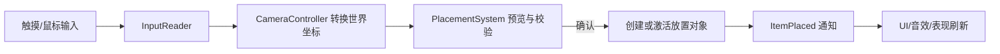
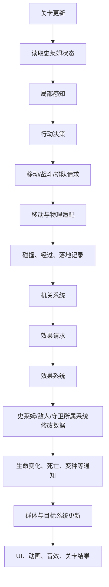
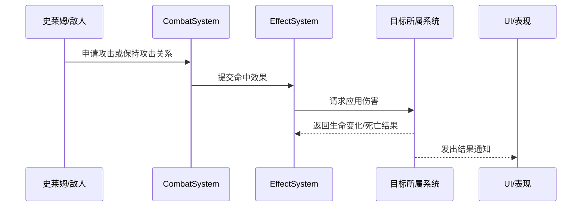
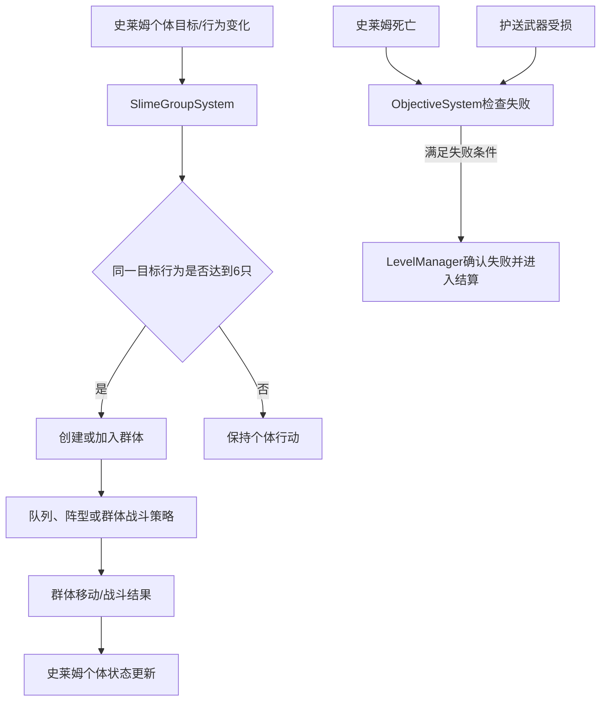

# 项目架构

版本：0.3 草案  
最后更新：2026-10-08  
适用范围：SlimeBattle-TapTapGamejam Unity 项目  
文档位置：`Assets/Docs/项目架构.md`

## 1. 文档定位与边界

本文件先回答三个问题：游戏需要完成什么、系统如何划分、数据和信息怎样流动。它不提前决定所有类名、算法和插件，也不规定团队成员分工。

架构中的“系统”表示一组有明确数据所有权和职责的规则，不等于必须创建一个同名的 Unity `GameObject` 或一个大型框架。

本文件与策划案、技术建议的关系如下：

- 当前对话中最新确认的需求是最高优先级。
- 策划文档提供玩法目标和体验方向，但其中的示例不自动成为实现要求。
- `SlimeBettle设计文档.docx` 的文字与图示是当前最新的策划输入；图示中标注“暂定”、文字与图示冲突或没有明确成功条件的内容，仍然标为待确认。
- 旧的可能架构草稿不再作为当前协作源；现行系统边界、接口和待确认项以本文件及 `Assets/Docs/Systems/` 中的文档为准。
- 具体实现方式可以在原型阶段保留多个选项；选项确定后必须回填本文件。

## 2. 需求分析

### 2.1 当前可追溯的需求

| 需求或约束 | 来源 | 当前状态 |
| --- | --- | --- |
| 项目是俯视角 2D 史莱姆群体引导游戏 | 策划文档 | 设计方向，需团队确认最终范围 |
| 玩家主要通过放置物品或改变环境影响史莱姆 | 策划文档、架构建议 | 核心方向，需拆成首个可玩闭环 |
| 史莱姆应表现出群体行为和涌现结果 | 策划文档 | 核心方向 |
| 游戏循环包含观察、判断、放置、涌现、意外和调整 | 策划文档 | 核心体验候选 |
| 当前方案将史莱姆上限设为 20 只，6 只及以上共享同一目标行为时可能形成群体 | 策划文档文字与群体行为图示 | 当前方案，数值仍需试玩确认 |
| 关卡失败条件包含史莱姆全部死亡或护送武器被摧毁 | 策划文档文字与流程图 | 当前方案，胜利条件和武器流程仍需补全 |
| 环境放置物包含食物、障碍和熔炉；总放置上限暂定为 5 | 策划文档图示 | 当前方案，放置物细则待确认 |
| 多周目在同一地图上连续推进，当前设想为 4 个场景、3 个周目 | 策划文档图示与文字 | 设计方向，不作为首个版本硬约束 |
| 项目使用 Unity `2022.3.62f2c1` | 当前工程 `ProjectVersion.txt` | 已确认 |
| 当前工程使用 URP 2D | 当前工程 | 已确认 |
| 输入统一使用新版 Unity Input System Package | 当前团队确认 | 已确认方案，具体 Action Map、Binding 和封装待定 |
| 目标平台暂定 Android | 架构建议 | 待制作与技术条件确认 |
| 2026-10-05 至 2026-10-21 的阶段排期 | 策划文档排期表 | 协作参考，不当作技术接口 |
| 轻度 Meta、多周目和多周目记忆 | 策划文档与架构建议存在差异 | 待确认 |

### 2.2 需求转成可验证能力

在具体玩法数值确定前，系统至少要能支持下列能力：

1. 加载一个关卡，并建立本局运行状态。
2. 读取输入并转换为世界位置，完成镜头操作或放置预览。
3. 创建、查询、更新和销毁史莱姆及其他运行时对象。
4. 让史莱姆根据局部信息产生行动意图，并由移动模块执行。
5. 让环境机关或战斗产生效果请求，作用于正确的目标系统。
6. 让系统在目标达成、失败、暂停和重开时保持一致的生命周期。
7. 让 UI 和表现读取状态、接收结果通知，但不拥有玩法规则。
8. 允许替换精灵、动画、音效和 UI，而不重写核心规则。
9. 能查询并维护当前关卡的护送武器状态，在武器被摧毁或史莱姆全部死亡时只确认一次失败结果。
10. 能在不把群体成员运行时数据混在一起的前提下，维护史莱姆群体的成员、目标、队列和战斗策略。
11. 能区分食物、障碍和熔炉的放置限制、生命周期与对史莱姆的引导作用。

这些能力是架构验收项，不代表每一项都必须在第一个原型中完整实现。

### 2.3 暂不锁定的内容

以下内容应等策划、美术和真机验证后再决定：

- 史莱姆的最终种类、优先级和行为复杂度；
- 坑、墙、跳跃、窄路和阻挡的具体物理表示；
- 机关类型、触发规则、效果数值和可重复次数；
- 敌人、战斗、围攻和关卡胜利目标的最终规则；
- 四个场景是否全部进入首个可交付版本；
- Meta、多周目、存档和跨关卡成长；
- 最终美术表现、动画数量、UI 布局和资源命名；
- Android 性能目标、守卫初始数量和各类放置物的最终数量限制；
- 史莱姆状态之间的优先级、叠加和互相抵消规则；
- 宠物、Meta、多周目记忆是否进入本次交付。

### 2.4 当前策划排期（非技术接口）

以下内容来自策划文档的排期表，只用于团队同步，不改变系统边界，也不代表每个阶段一定能完成对应功能：

| 日期 | 策划/美术方向 | 开发方向 |
| --- | --- | --- |
| 10.05—10.09 | 第一、二场景、部分 UI、部分角色原画 | 页面交互、场景搭建、角色状态 |
| 10.10—10.14 | 第三、四场景、部分角色动作、全部角色原画 | 宠物、史莱姆和怪物行为与战斗；第一周目 |
| 10.15—10.19 | 封面、全部道具、角色动作和 UI | 资源导入、场景交互；三周目 |
| 10.20—10.21 | 验收资源和收尾 | Bug 修复、验收和预留时间 |

排期中的“宠物”“三周目”等内容，只有在首个可玩闭环稳定后才进入实现承诺。

## 3. 架构原则

### 3.1 数据所有权优先

每一份会变化的运行时数据只有一个正式修改者。其他系统只能读取，或通过命令请求所属系统修改。

### 3.2 命令与通知分开

- **查询**：读取另一个系统的数据，但不修改它，使用只读方法或查询对象。
- **命令/请求**：希望另一个系统完成某件事，使用明确的方法或请求对象。
- **事件/通知**：某件事已经完成，使用类型明确的事件通知关心者。

例如，机关不能直接修改史莱姆生命；它提交效果请求，效果系统调用史莱姆系统应用伤害；史莱姆系统完成扣血后再发出生命变化或死亡事件。

第一版不建立万能消息系统。能明确找到办理者的规则修改优先使用直接调用或明确请求；需要通知多个观察者的结果再使用事件。

EventBus 只属于当前关卡，由当前关卡的 `LevelContext` 或 `LevelManager` 创建和销毁，不使用跨场景的全局静态 EventBus。关卡离开或重开时，必须先停止本局运行、取消待处理任务并清理订阅，再销毁本局 EventBus。

### 3.3 逻辑与表现分开

玩法是否发生不能依赖镜头、动画、特效和 UI 是否成功。表现层可以延迟、跳过或替换，但必须能够从当前状态重新同步。

### 3.4 先建立边界，再选择实现

先确定输入、输出、数据所有权和生命周期，再选择行为树、状态机、物理方案或事件实现。不要因为尚未确定算法而让多个系统直接修改同一份数据。

## 4. 系统划分

下面是逻辑系统。它们是第一版的边界，不要求现在就为每个系统建立复杂抽象。

### 4.1 应用与关卡流程系统

**职责**：启动项目、加载和卸载关卡、建立本局系统、暂停、重开、结束和切换关卡。

**拥有的数据**：当前关卡上下文、运行阶段、暂停状态、关卡目标状态和本局生命周期。

**输入**：进入关卡、暂停、重开、返回、关卡结果。

**输出**：初始化系统、驱动更新时间、发出关卡开始/结束通知。

**不负责**：选择史莱姆行动、计算伤害、播放 UI 动画。

默认实现名称为 `GameRoot`、`LevelManager` 和 `LevelContext` 三层。先按生命周期是否清晰来决定具体类数量，不以类数量作为架构质量标准。

### 4.1.1 目标与护送系统

**职责**：保存当前关卡的目标状态，管理被护送武器的运行时状态，并把失败条件转换为关卡流程可确认的结果。

**拥有的数据**：`ObjectiveRuntimeData`、`WeaponRuntimeData`、目标阶段、武器生命和武器是否已摧毁。

**输入**：关卡配置、武器受击结果、史莱姆死亡结果、目标达成检查请求。

**输出**：目标状态查询、武器状态查询、武器受击请求和目标结果通知。

**不负责**：决定敌人如何攻击、直接修改武器表现或替代 `LevelManager` 执行场景重开。

该系统的具体名称暂定为 `ObjectiveSystem`，当前策划明确的失败分支是“史莱姆全部死亡”或“护送武器被摧毁”；武器最终要被护送到哪里、何时判定成功仍待策划补全。

### 4.2 配置与内容系统

**职责**：提供史莱姆、机关、敌人、物品和关卡的设计时配置。

**拥有的数据**：不可变或编辑时配置，例如初始生命、移动参数、效果参数、预制体和资源引用。

**输入**：关卡 ID、内容 ID、配置资产。

**输出**：经过校验的配置查询结果。

**不负责**：保存本局生命、冷却、队列和目标。

候选实现：优先考虑 ScriptableObject；若配置规模和工具需求改变，可以保留其他序列化方案。配置 ID、缺失引用和重复 ID 需要在加载或编辑器检查阶段报错。

### 4.3 史莱姆系统

**职责**：管理史莱姆实例、生成、存活状态、生命、种类、变种和死亡。

**拥有的数据**：`SlimeRuntimeData`，包括实例 ID、配置 ID、生命、状态效果、是否存活等。

**输入**：生成请求、伤害/治疗/变种请求、行动结果、重开清理请求。

**输出**：存活数量查询，以及出生、生命变化、变种、死亡等通知。

**不负责**：决定某个机关是否触发、播放动画、直接接管物理位置。

史莱姆系统内部采用“决策树 + 状态机”的结构：

- 决策树负责主动感知环境、读取自身和周围信息，并选择下一步行动意图。
- 状态机负责接收行动意图、执行当前行动，以及处理外部控制、停顿和行动中断。
- 史莱姆系统负责创建、驱动和销毁每只史莱姆的决策树与状态机实例。

这是史莱姆系统的内部组织方式。为了多人协作，决策树和状态机拥有单独的设计文档和稳定的内部契约，但它们不是全局单例，也不直接拥有所有角色的行为数据。状态机的具体状态、转换条件和决策树节点，等策划明确行为规则后再确定。

史莱姆个体的群体归属、共同目标、队列/阵型和群体战斗策略由 `SlimeGroupSystem` 持有；`SlimeSystem` 仍然拥有每个个体的生命、状态和存活结果。群体规则包括：同一目标行为达到 6 只时可形成群体、最多同时存在 3 个群体、目标消失后等待 10 秒再解散、人数少于 6 时立即解散。图示还提出自动列队、绕开障碍和三种群体战斗策略，均以当前策划方案记录，具体优先级和数值待验证。

### 4.4 史莱姆决策树模块

这是史莱姆系统内部的决策模块，不预先作为独立的公共系统拆出。

**职责**：读取单只史莱姆可见的局部信息，选择下一项行动或等待。

**拥有的数据**：当前目标、行动意图和思考计时。具体决策节点和优先级待策划规则确定。

**输入**：自身状态、感知查询结果、排队/战斗/移动结果。

**输出**：移动意图、攻击请求、排队请求、等待或目标切换请求。

**不负责**：直接修改生命、直接写入刚体位置或决定最终伤害。

本项目当前采用决策树承担感知和决策；状态机负责后续的行动执行。系统接口先表达“感知—决策—行动意图”，不提前锁定具体节点和状态。

### 4.5 移动与空间交互系统

**职责**：把移动意图转换为实际移动，处理阻挡、跳跃、落地、碰撞和空间占用。

**拥有的数据**：当前移动动作、移动执行进度、与 Unity 物理对象的适配状态。

**输入**：移动意图、停止/取消、地图空间查询结果。

**输出**：移动完成/失败、落地、接触和路径经过信息。

**不负责**：选择史莱姆为什么要移动、决定机关效果或修改史莱姆生命。

状态机通过本系统或其内部适配组件执行移动行动。移动系统只报告执行中的结果、完成、失败和接触信息，不替决策树选择目标，也不替状态机决定下一项行动。

候选实现：Rigidbody2D 物理、运动学控制或自定义空间模拟。最终选择需要用小型测试场景验证推挤、跳跃、坑、墙和性能。

### 4.6 机关与窄路系统

**职责**：管理机关触发、冷却、使用次数、范围、窄路占用和排队规则。

**拥有的数据**：机关运行状态、触发状态、剩余次数、冷却、窄路通行记录和等待顺序。

**输入**：碰撞/经过记录、进入/离开窄路请求、配置数据。

**输出**：效果请求、允许通过/等待/离开结果、机关状态变化通知。

**不负责**：直接扣生命、播放机关表现、直接修改史莱姆行为树。

当前策划中的环境元素至少包括：

- 食物：可引导范围内的史莱姆，被吃掉后消失，图示暂定再次放置间隔为 10 秒；
- 障碍：数量有限，用于让史莱姆重新寻找路线，每个场景的数量可不同；
- 熔炉：单个可重复使用，可吸引较大范围史莱姆，拆除后图示暂定 20 秒后才能重新安装；
- 组合放置可能形成路径、阵型和连锁反应，元素还会与地形和敌人相互作用。

总放置上限为 5 的标注仍属于暂定规则，不能在系统接口中写成不可变常量。

### 4.7 效果系统

**职责**：接收并按统一规则处理伤害、治疗、增殖、变种、击退等效果。

**拥有的数据**：待处理效果请求及其执行状态。它不拥有目标的最终生命或种类。

**输入**：来源 ID、目标 ID、效果类型、数值、时机和上下文。

**输出**：调用目标所属系统完成修改，并通知效果执行结果或失败原因。

**不负责**：在多个地方重复扣血、决定目标是否死亡、从表现事件中推断规则结果。

### 4.8 敌人与战斗系统

敌人系统拥有敌人运行数据、生命和死亡；战斗系统负责攻击请求、攻击间隔、命中时机和目标关系。战斗系统通过效果系统作用于敌人或史莱姆，不直接修改目标生命。

敌人行为和战斗流程在文档中分开记录；实现时可以暂时放在同一程序集或较小的代码模块中，但必须保持“目标生命由目标所属系统修改”的数据边界。

当前敌人图示提出：普通敌人在场景固定范围内活动，目标进入索敌范围后攻击距离最近的单位，通常不会逃跑并战斗至死；部分敌人的人类优先目标规则待后续设定。守卫围绕护送武器待命，不主动攻击，只有靠近武器且处于战斗状态的魔物，或正在攻击武器的敌人，才会触发守卫攻击。

### 4.9 输入、镜头与放置系统

**输入系统**统一基于新版 Unity Input System Package，把触摸或鼠标输入转换为语义输入，例如拖动镜头、点击世界、确认放置和取消。具体 Action Map、Binding、设备兼容和输入封装方式仍待确定。

**镜头系统**只负责视图位置、边界和缩放，不决定世界是否运行。

**放置系统**负责选择物品、预览、合法性检查、确认放置和取消；成功后提交放置结果并通知 UI。它不能绕过规则直接把任意预制体塞进场景。

放置系统需要把“物品是否还能放置、放置冷却、场景总上限和当前位置是否合法”作为同一次确认中的校验项；食物、障碍和熔炉的实际实现仍由 `MechanismSystem` 与关卡配置共同确定。

### 4.10 UI 与表现系统

**职责**：显示状态、意图、提示、菜单、结算和反馈。

**输入**：主动查询的当前状态，以及系统已经发出的事件。

**输出**：用户操作请求，不直接写入玩法数据。

UI 打开时先读取一次当前状态，再监听后续变化，避免因为错过历史事件而显示错误。

### 4.11 具体系统名称与设计文档索引

为便于协作，上一节的职责摘要进一步拆分为下列具体系统。每个系统的命名空间、核心数据、公共接口、事件、依赖和验收场景见对应文档。

#### 应用与关卡核心

| 编号 | 系统 | 核心职责 | 详细文档 |
| --- | --- | --- | --- |
| `CORE-01` | `GameRoot` | 应用级初始化、全局服务和入口编排 | [01-GameRoot](Systems/01-GameRoot.md) |
| `CORE-02` | `LevelManager` | 关卡加载、重开、暂停、结果和卸载 | [02-LevelManager](Systems/02-LevelManager.md) |
| `CORE-03` | `LevelContext` / `LevelEventBus` | 当前关卡的系统边界、生命周期和局部通知 | [03-LevelContext与EventBus](Systems/03-LevelContext与EventBus.md) |
| `CORE-04` | `ObjectiveSystem` | 护送武器、关卡目标和失败条件 | [23-ObjectiveSystem](Systems/23-ObjectiveSystem.md) |

#### 数据、角色与 AI

| 编号 | 系统 | 核心职责 | 详细文档 |
| --- | --- | --- | --- |
| `DATA-01` | `ConfigSystem` | ScriptableObject 配置查询和校验 | [04-ConfigSystem](Systems/04-ConfigSystem.md) |
| `ACTOR-01` | `ActorCore` | 角色身份、阵营、快照和公共契约 | [05-ActorCore](Systems/05-ActorCore.md) |
| `AI-01` | `DecisionTreeSystem` | 角色感知、评估和行动意图选择 | [06-DecisionTreeSystem](Systems/06-DecisionTreeSystem.md) |
| `AI-02` | `StateMachineSystem` | 行动执行、状态切换和外部中断 | [07-StateMachineSystem](Systems/07-StateMachineSystem.md) |
| `ACTOR-02` | `SlimeSystem` | 史莱姆生成、销毁、运行时数据和 AI 驱动 | [08-SlimeSystem](Systems/08-SlimeSystem.md) |
| `ACTOR-05` | `SlimeGroupSystem` | 史莱姆群体形成、成员、队列、阵型和群体策略 | [22-SlimeGroupSystem](Systems/22-SlimeGroupSystem.md) |
| `ACTOR-03` | `EnemySystem` | 敌人实例、运行时数据和行为接入 | [09-EnemySystem](Systems/09-EnemySystem.md) |
| `ACTOR-04` | `GuardSystem` | 守卫实例、AI/外部控制和运行时数据 | [10-GuardSystem](Systems/10-GuardSystem.md) |

#### 世界、机关与战斗

| 编号 | 系统 | 核心职责 | 详细文档 |
| --- | --- | --- | --- |
| `WORLD-01` | `MapSystem` | 读取场景地图并提供边界、出生点和空间查询 | [11-MapSystem](Systems/11-MapSystem.md) |
| `WORLD-02` | `MovementSystem` | 执行移动、处理阻挡和报告接触事实 | [12-MovementSystem](Systems/12-MovementSystem.md) |
| `MECH-01` | `MechanismSystem` | 机关生命周期、触发和冷却 | [13-MechanismSystem](Systems/13-MechanismSystem.md) |
| `MECH-02` | `PassageSystem` | 窄路占用、排队和通行结果 | [14-PassageSystem](Systems/14-PassageSystem.md) |
| `COMBAT-01` | `StatusManager` | 伤害、击退、易伤和持续状态的统一处理 | [15-StatusManager](Systems/15-StatusManager.md) |
| `COMBAT-02` | `CombatSystem` | 攻击请求、命中判定和效果请求 | [16-CombatSystem](Systems/16-CombatSystem.md) |

#### 玩家、镜头、UI 与表现

| 编号 | 系统 | 核心职责 | 详细文档 |
| --- | --- | --- | --- |
| `PLAYER-01` | `InputSystem` | Input System Package 输入读取和语义化 | [17-InputSystem](Systems/17-InputSystem.md) |
| `PLAYER-02` | `PlacementSystem` | 放置预览、校验、确认和取消 | [18-PlacementSystem](Systems/18-PlacementSystem.md) |
| `PRESENT-01` | `CameraSystem` | 2D 镜头、边界和坐标转换 | [19-CameraSystem](Systems/19-CameraSystem.md) |
| `UI-01` | `UISystem` | 状态显示、界面流程和 UI 指令 | [20-UISystem](Systems/20-UISystem.md) |
| `PRESENT-02` | `PresentationSystem` | 动画、特效、音效和表现反馈 | [21-PresentationSystem](Systems/21-PresentationSystem.md) |

本批次暂定根命名空间为 `SlimeBattle`。跨系统公共接口集中登记在 [99-全局API查询表](Systems/99-全局API查询表.md)；系统内部接口不进入全局表。

## 5. 核心运行时数据

### 5.1 配置数据与运行时数据

```text
配置数据：设计时输入，通常只读
    SlimeConfig / SlimeGroupConfig / MechanismConfig / EnemyConfig / GuardConfig
    LevelConfig / ObjectiveConfig / WeaponConfig / PlacementItemConfig

运行时数据：本局变化，由所属系统拥有
    SlimeRuntimeData / SlimeGroupRuntimeData / MechanismRuntimeData
    EnemyRuntimeData / GuardRuntimeData / ObjectiveRuntimeData / WeaponRuntimeData
```

配置资产不能直接作为本局状态使用。多个史莱姆可以共享同一份配置，但不能共享生命、目标、行动进度和排队状态。

### 5.2 数据所有权表

| 数据 | 正式拥有者 | 其他系统的使用方式 |
| --- | --- | --- |
| 当前关卡阶段、暂停和重开状态 | 关卡流程系统 | 查询或发送流程请求 |
| 关卡目标和护送武器状态 | `ObjectiveSystem` | 查询目标，提交受击/达成事实 |
| 史莱姆生命、种类、存活 | 史莱姆系统 | 提交效果/变种请求，读取结果 |
| 史莱姆行动意图和目标 | 决策系统实例 | 提交移动、战斗或排队请求 |
| 史莱姆群体成员、共同目标、队列和策略 | `SlimeGroupSystem` | 史莱姆系统提交加入/离开/目标变化事实 |
| 实际空间位置和物理状态 | 移动/物理适配系统 | 读取位置，提交移动意图 |
| 机关冷却和触发次数 | 机关系统 | 提交接触记录，读取机关结果 |
| 待处理效果 | 效果系统 | 提交效果请求 |
| 敌人生命和存活 | 敌人系统 | 通过效果系统请求修改 |
| 物品数量和放置合法性 | 放置系统或关卡资源系统 | 提交预览/确认请求 |
| UI 显示状态 | UI/表现层缓存 | 从所属系统查询或由事件刷新 |

## 6. 系统间信息流

### 6.1 进入关卡


初始化应采用明确顺序。组件可以在 `Awake` 缓存自己的 Unity 引用，但系统之间的连接不能依赖若干脚本 `Start()` 的偶然先后。

### 6.2 玩家放置



合法性判断必须由放置系统完成。UI 只提交请求，不通过按钮回调直接修改资源数量或场景层级。

### 6.3 史莱姆行动与环境影响



一次规则结果应先由数据所属系统完成，再通知表现层。死亡动画、音效或 UI 不能反过来决定是否死亡。

### 6.4 战斗效果



### 6.5 史莱姆群体与关卡失败



群体系统只拥有群体关系和策略，不替 `SlimeSystem` 修改个体生命；目标系统只确认目标结果，不替敌人、守卫或史莱姆计算攻击和伤害。

## 7. 系统依赖方向

默认依赖方向如下：

```text
Core / Contracts
        ↑
Gameplay Systems  ←→  Content Config
        ↑
Presentation / UI / Audio
```

更具体的约束：

- Core 可以定义生命周期和公共数据契约，但不依赖具体 UI 或美术资源。
- 玩法系统可以读取配置和 Unity 适配组件，但不直接操纵 UI、动画和音效。
- UI 与表现层可以订阅玩法结果，但不能成为玩法系统的依赖前置。
- EventBus 或事件聚合器只负责传递通知，不保存完整运行时数据。
- 不允许通过循环引用让两个系统互相修改对方的内部数据。
- 若两个系统需要共享规则，应先定义一个清晰的请求或查询边界；不要复制一份会自行变化的数据。

## 8. 生命周期与更新顺序

### 8.1 应用级生命周期

`GameRoot` 是应用级对象，可以跨场景存在，负责全局设置、场景切换、主菜单入口和全局暂停入口。它不直接管理史莱姆、机关或敌人的运行时数据。

应用级流程为：

```text
启动 → 主菜单 → 加载关卡 → 运行关卡 → 结算
                         ↓
              下一关 / 重开 / 返回主菜单
```

### 8.2 关卡级生命周期

`LevelManager` 管理当前关卡，每次进入关卡时创建新的 `LevelContext`，离开关卡时销毁旧上下文。单局关卡状态为：

```text
未加载
  → 加载中
  → 初始化
  → 运行中 ⇄ 暂停
  → 结算中
  → 重开或离开
  → 清理
```

已确认的生命周期规则：

- 暂停时停止史莱姆 AI、移动、物理、机关冷却、攻击计时和效果计时。
- 暂停时菜单和必要的 UI 输入仍然可用。
- 成功或失败只允许确认一次，进入结算状态后不再产生新的玩法结果。
- 结算状态持续到玩家选择下一关、重开或返回主菜单。
- 重开通过重新加载当前关卡场景完成，不在第一版采用原场景内局部重建。
- 离开关卡时清理本关系统、事件订阅和运行时对象。

### 8.3 关卡初始化顺序

进入关卡后采用明确的初始化流程：

1. 加载关卡场景和关卡配置。
2. 创建本局 `LevelContext`，记录关卡 ID 和当前生命周期状态；如果未来存在跨场景或异步边界，再为上下文增加本局 ID。
3. 注册场景中的出生点、目标、护送武器、机关、窄路和其他关卡标记。
4. 创建当前关卡需要的系统，并注入它们需要的配置和引用。
5. 创建并初始化 `ObjectiveSystem`，注册护送武器和失败条件。
6. 生成史莱姆、敌人、守卫和其他初始运行时对象。
7. 让 UI 主动读取一次初始状态。
8. 发出关卡开始通知，进入运行状态。

Unity 组件可以在 `Awake` 中缓存本地引用，但系统之间的连接和初始化不能依赖多个脚本 `Start()` 的偶然先后顺序。

### 8.4 运行阶段顺序

以下是已经确定的逻辑阶段顺序；具体映射到 `FixedUpdate`、手动 Tick 或其他驱动方式，仍属于实现选择：

1. 接收上一轮物理和碰撞结果。
2. 整理机关接触、攻击命中和待处理请求。
3. 效果系统执行本轮效果，目标所属系统修改数据并处理死亡。
4. 更新窄路、史莱姆群体、队列和关卡目标。
5. 让仍可行动的史莱姆进行感知和决策。
6. 将移动意图交给移动/物理适配系统。
7. 等待 Unity 物理或选定的模拟方式产生下一轮结果。

该顺序用于保证：同一轮已经死亡的对象不会继续行动；碰撞回调不会直接生成或销毁一大批对象；新产生的后续效果和新出生对象可以从下一轮开始处理。

### 8.5 重开与清理

重新加载当前关卡场景前，关卡控制器应停止本局运行并取消本局请求。重新加载后，旧的运行时对象、事件订阅、队列、效果、AI 行动记录和临时计时器不得继续存在。

由于重开通过重新加载当前关卡场景完成，第一版不强制把本局 ID 放入每一个请求和事件。重开隔离依赖以下条件：

- EventBus 只属于当前关卡，不由 `GameRoot` 或静态对象持有；
- 关卡卸载前停止本局运行，并取消待处理的协程、计时器、异步任务和请求；
- 旧场景对象和系统不继续向新场景发送消息；
- 运行时对象仍然必须使用实例 ID，不能只依赖场景对象引用。

如果未来出现持久化对象、跨场景异步任务、对象池延迟回调或网络请求，再增加本局 ID、代际编号或等价的有效性检查，作为跨边界保护。

## 9. 系统边界与对外契约

架构文档不预先列出所有系统方法、查询接口和事件名称。具体接口属于系统内部设计，只有确实被其他系统依赖的部分才需要形成公共契约。当前跨系统公共接口的查询入口是 [`Assets/Docs/Systems/99-全局API查询表.md`](Systems/99-全局API查询表.md)，完整职责仍以各系统文档为准。

每个系统在设计自己的公共边界时，应回答以下问题：

1. 系统负责什么，明确不负责什么？
2. 哪些运行时数据由系统拥有并修改？
3. 其他系统可以向它提出哪几类请求？
4. 其他系统可以查询哪些只读信息？
5. 在什么条件下需要发布对外事件？
6. 请求成功、失败、等待和取消分别如何表达？
7. 关卡暂停、重开和卸载时，哪些请求和事件会失效？

具体方法名、参数类型、内部事件和辅助类由系统实现者决定；只有跨系统使用的部分才需要记录到系统自己的设计说明或公共接口说明中。

### 9.1 公共契约的最低内容

跨系统公共契约至少说明：

- 能力目的，而不是内部实现步骤；
- 输入信息的含义和生命周期；
- 成功、失败、等待和取消的结果；
- 数据由哪个系统最终修改；
- 是否会产生对外通知，以及通知代表的已完成结果。

如果某项能力只有一个内部调用方，优先保留在系统内部，不为它建立全局抽象。

### 9.2 系统内部事件与对外事件

系统可以自由使用内部事件、状态机或回调组织自己的实现。只有会影响其他系统判断或表现的已完成结果，才需要发布对外事件。

对外事件应满足：

- 表示已经发生的结果，而不是即将发生的意图；
- 不让监听者承担原系统的数据修改职责；
- 只携带跨系统真正需要的信息；
- 在系统销毁、关卡重开和 EventBus 清理时失效。

公共契约发生变化时，只更新受影响的系统说明和调用方，不维护一个包含所有内部消息名称的全局清单。

## 10. 可保留的实现选项

| 问题 | 候选方案 | 选择依据 |
| --- | --- | --- |
| 行为决策 | 行为树、有限状态机、优先级规则 | 史莱姆数量、行为复杂度和调试成本 |
| 移动与碰撞 | Rigidbody2D、运动学移动、自定义模拟 | 推挤、跳跃、阻挡、坑和性能验证 |
| 系统连接 | 明确引用、初始化容器、轻量服务注册 | 引用可追踪性和场景重开可靠性 |
| 事件通知 | 类型化 C# 事件、轻量 EventBus | 订阅清理、调试和跨系统数量 |
| 配置资产 | ScriptableObject、序列化数据文件 | 策划编辑体验和运行时读取方式 |
| 对象复用 | 暂不使用、局部对象池 | 只有在真机或 Profiler 证明需要时引入 |
| 存档与 Meta | 暂不实现、简单本地存档、完整跨关卡状态 | 首个可玩版本范围与时间 |

候选方案不是同时实现的任务。每个选项最终只保留一个当前实现，并在本节记录选择理由。

## 11. 架构验收场景

在正式关卡之外，至少保留一个小型测试场景，能够快速检查：

- 史莱姆生成、移动、阻挡和死亡；
- 机关接触与效果只执行一次；
- 多个目标共享配置但不共享运行时生命和行动状态；
- 窄路等待、通行、离开和中途死亡；
- 重开后没有旧对象、旧事件、旧计时器或旧队列；
- 镜头移开后规则仍继续运行；
- UI 或动画缺失时，核心规则仍能完成；
- 放置预览、确认、取消和非法位置处理。

测试场景的通过结果只能说明该场景和规则路径通过，不能代替 Android 真机、完整关卡或玩家体验验证。

## 12. 待决策与更新规则

以下内容应由团队确认后补入本文件：

- 首个可玩闭环的具体目标和范围；
- 关卡数量、地图规模和关卡切换方式；
- 护送武器的移动/交付方式、最终胜利条件和守卫初始数量；
- Input System 的 Action Map、Binding 和输入封装约定；
- 屏幕适配、物理和移动方案；
- 史莱姆个体状态的优先级、群体合并规则和群体战斗策略数值；
- 图示中史莱姆饥饿触发暴躁的 90/120/150 秒规则与正文“90 秒后每 10 秒 20%”规则的统一方式；
- 食物、障碍、熔炉的放置数量、冷却、引导范围和触发效果；
- 普通、特殊和 Boss 敌人的目标优先级与生成方式；
- 配置资产和事件实现方式；
- Meta、多周目、存档是否进入本次交付；
- Android 性能指标和压力测试档位。

每次架构决定至少记录四项：决定内容、选择理由、影响的系统、需要同步的文档或测试。已经被实现验证推翻的方案，不删除历史结论，只标记为废弃并记录替代方案。

