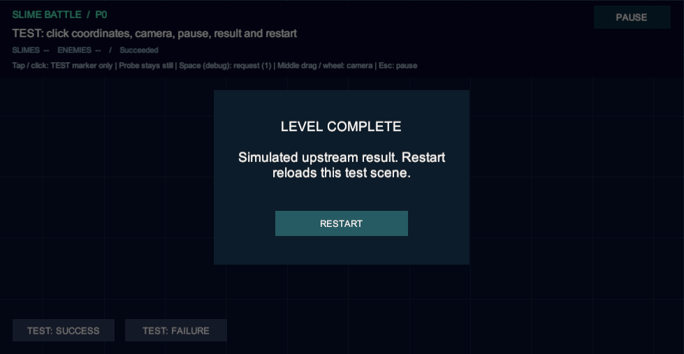

# P0 小宸部分：可重复测试

目标编辑器：**Unity 2022.3.62f2c1**，基于 **master e0011d1**。范围为输入事实、坐标投影、镜头、基础 UI 与 Core 流程接入。

## 启动

1. 用指定编辑器打开项目，等待包恢复，确认无 C# 编译错误。沿用 master 的 Input System 1.14.2。
2. 退出 Play Mode，选择 **SlimeBattle → Tests → Run P0 Player Checks**；Console 应输出 PASS。检查投影、边界、模式、输入订阅隔离、解绑与 UI 状态。
3. 选择 **SlimeBattle → Tests → Open P0 Player Bootstrap**，再点击 Play。应从 Bootstrap_P0Player 进入 Test_PlayerPresentation，看到网格、静止青色 InputProbe、目标 HUD、Pause 和底部 TEST 结果按钮。

测试资产只在本目录；不要直接运行测试关卡，不要把夹具放入正式场景。菜单修改的 EditorBuildSettings 属于本地测试设置，验证后检查 diff，不随 PR 提交。

## 自动 Play Mode 检查

退出 Play Mode 后选择 **SlimeBattle → Tests → Run P0 Play Mode Checks**。先执行编辑器检查，再进入真实 Play Mode，使用虚拟 Mouse、Touchscreen、Keyboard 检查鼠标/触屏一次点击一个 PrimaryAction、按下/移动/释放事件、重复快照读取、屏幕到世界坐标、UI 起始手势屏蔽、静止探针、镜头中键/滚轮、暂停恢复、模拟失焦回调、结果显示和连续五次重开。每次重开检查 HUD、CameraSystem、EventSystem 唯一及旧手势/标记清理；旧输入 token 不能取消新实例订阅。

检查恢复原 Build Settings、移除虚拟设备并退出 Play Mode；默认报告为系统临时目录中的 SlimeBattleP0-validation.json。有图形设备时保存结算截图。命令行示例：

```text
<Unity.exe> -projectPath <project-path> -executeMethod SlimeBattle.Tests.PlayerPresentation.Editor.P0PlayerPlayModeChecks.Run -p0ReportPath <report.json> -p0ExitAfterChecks -logFile <editor.log>
```

需要图形界面和获得焦点的 Game 视图，不加 -batchmode、-nographics 或 -quit。关闭抢焦点的 MCP Setup 浮窗，检查期间勿用实体键鼠操作 Game 视图。命令行入口成功退出 0、失败退出 1；菜单入口保留编辑器。导入脚本不会自动运行检查。

## 手动操作与预期

| 操作 | 预期 |
| --- | --- |
| 鼠标点击 / 主触点轻触空白网格 | TEST_ONLY_ClickMarker 出现在投影位置；青色 InputProbe 始终静止 |
| 再点另一位置 | 仅标记换位置；松手不会触发角色移动 |
| 长按、移动、释放 | 一次 PrimaryAction，分别可观察指针事实；没有连续点击或自动移动 |
| WASD / 方向键 | 默认无 Move；仅显式方向调试开关启用时绑定，夹具仍不移动探针 |
| 空格 | 仅调试请求计数 / 闪色，不攻击、扣血或移动 |
| 在 HUD 上按下后拖到网格释放 | 不产生地图操作，标记不更新 |
| 网格上中键拖动、滚轮 | 镜头平移 / 缩放，标记与探针世界坐标不变 |
| 持续向边界拖动 / 改变 Game 视图宽高比 | 按视口约束镜头；小地图居中，无非法坐标 |
| Esc / Pause | Core 进入 Paused；显示暂停面板，清除标记，不接受新地图操作 |
| Esc / Resume | 回到 Running；旧标记不恢复，按住触点须先松开，再次点击才有效 |
| TEST: SUCCESS / FAILURE | 模拟上游向 Core 确认结果；显示成功 / 失败和 Restart，屏蔽地图输入 |
| 暂停 / 结果面板 Restart | 重载当前测试关卡，标记隐藏、探针原点、请求计数和镜头重置 |
| 快速重复 Restart，交替结果后重开至少五次 | 只处理一轮加载；HUD、CameraSystem、EventSystem 各一个，回调不倍增 |

TEST_ONLY_ClickMarker 是坐标验证标记，InputProbe 是静止参照，都不是 Actor。PrimaryAction 只表示主要操作发生的屏幕位置；本次不实现放置物、角色选择、移动控制、寻路或攻击规则。

## 异常与生命周期

1. **真实窗口失焦（手动）**：点网格、松开，切到其他窗口再切回。标记应清除，没有旧输入；重新点击正常。自动检查只直接发送本组件的 OnApplicationFocus 回调，不能替代真实操作系统 / 真机焦点验证。
2. **按住触点恢复 / 重开**：保持触点或调试攻击键，用公开入口恢复 / 重开。旧输入无效；松开后新点击正常。
3. **晚启用 UI**：禁用 UISystem，点击 TEST 结果，再启用；应读取当前 Core 阶段并显示结果。
4. **UI 缺失**：禁用 BattleHUD，地图点击仍可更新测试标记。重新启用后按钮正常。
5. **无快照源**：独立场景不给 IUiSnapshotSource；显示 Waiting for objective data 和 --，不把未知数量当零存活。
6. **加载失败**：Play 前禁用测试关卡的 Build Settings 注册；Core 应报告加载失败。无关卡 UI 时不承诺错误面板；恢复注册后重试。关卡内重开失败由 HUD 显示提示并解除 pending。
7. **非法边界 / 模式 / 订阅**：编辑器检查拒绝非法值、null handler；默认 token、重复解绑、其他输入实例 token 不影响有效订阅。

## 后续接入

- 关卡适配层通过 MapManager.GetMapBounds 公开接口构造 CameraBounds，再 SetBounds；镜头不读取地图内部或校验放置。
- IUiSnapshotSource 适配目标 / Manager 的公开快照；UI 不推断胜负。
- 未来放置 / 交互适配层消费 PrimaryAction.ScreenPosition，经 CameraSystem.ScreenToWorld 得到世界坐标。本 PR 不创建此层，不要求 Actor 接入点击移动。
- 未来选择面板可作为独立 uGUI 子面板或注入视图扩展；当前不写死 PlacementItem、消耗、网格、地形、确认 / 取消规则。
- 输入订阅改用 InputSubscriptionToken；显式旧 Core.SubscriptionToken 声明须迁移。禁用解绑，重开绑定新实例。

## 执行记录与边界

2026-10-10，master e0011d1 基础上，反馈修订版使用 Unity 2022.3.62f2c1（92e6e6be66dc）：C# 编译通过，**20 项编辑器检查 + 47 项 Play Mode 检查全部通过**，编辑器退出码 0。覆盖上述鼠标 / 虚拟触屏、镜头、UI、模拟失焦回调与连续五次重开。旧点击自动移动版本的验收约定已撤回。

本轮重新运行既有 SlimeBattle.P0.Tests 为 **11 通过 / 12 失败**（退出码 2），失败集合与同步 master e0011d1 时完全相同，无新增失败。Actor 旧夹具未先添加具体 Collider2D，另有 LevelContext 夹具缺必需 Prefab；涉及 ActorAiEditModeTests.cs、ActorManagerEditModeTests.cs、P0SystemsEditModeTests.cs。本 PR 不修改这些实现或测试。

尚未验证 Android 真机、多指、正式放置、完整 AI / 战斗链路、中文字体与安全区域。触屏镜头拖动 / 双指缩放需另行确定手势规则。通过虚拟触屏不能宣称真机通过。

下图是本轮反馈修订版的结算截图，成功由测试控件模拟上游确认：


