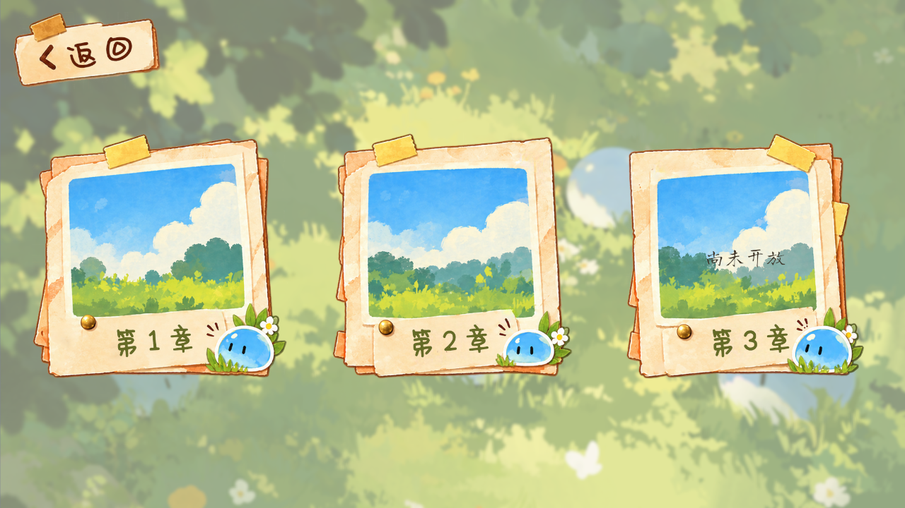
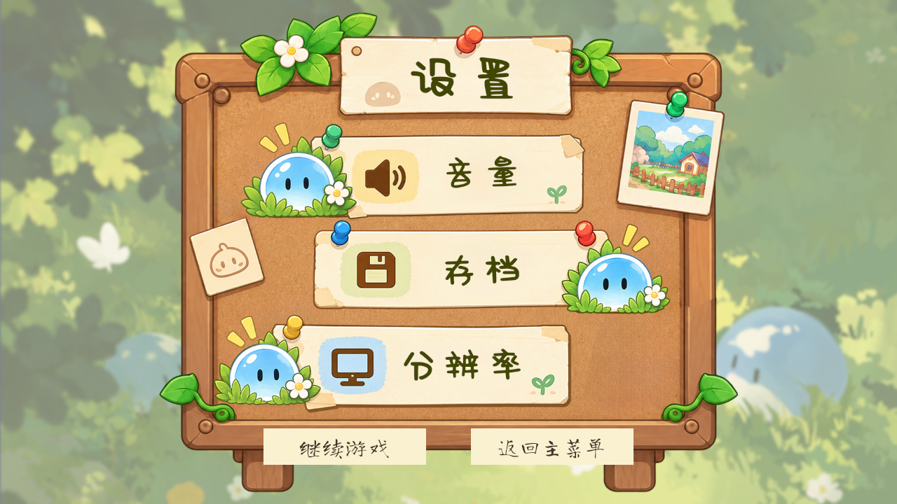
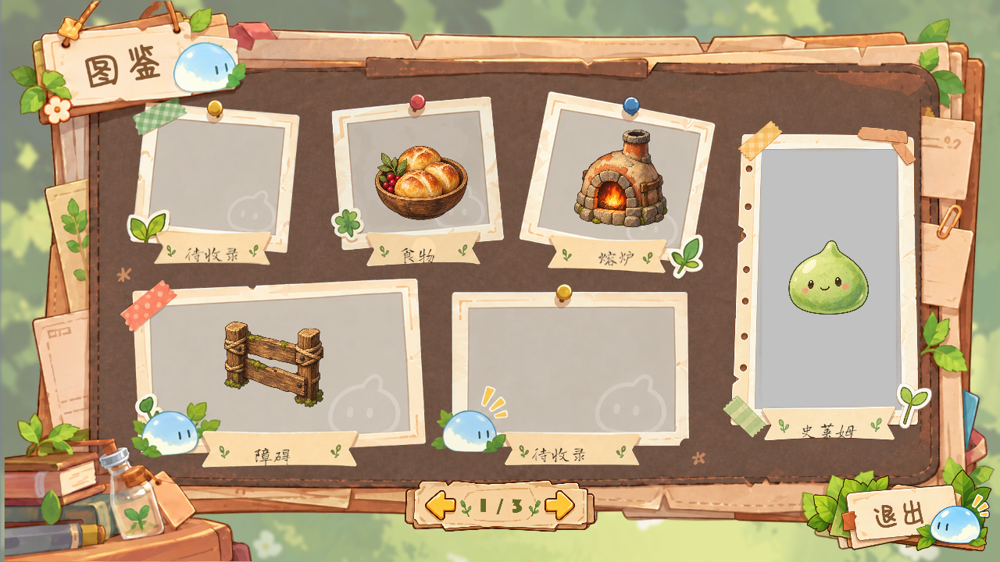

# TapTap UI 审阅记录（2026-10-20）

这些文件是本轮 UI 接入的测试及截图证据，不参与运行时加载。

| 阶段 | 文件 | 通过 / 失败 |
| --- | --- | --- |
| 素材导入与放置回归 | UIImport-EditMode.xml | 70 / 0 |
| 素材导入 UI 回归 | UIImport-PlayMode.xml | 9 / 0 |
| 正式场景重查 | Production-PlayMode.xml | 1 / 0 |
| 返回主菜单后的 UI 回归 | Return-EditMode.xml | 16 / 0 |
| 返回主菜单与正式场景回归 | Return-PlayMode.xml | 10 / 0 |

各轮测试存在重叠，不作为独立测试数相加。返回流程测试通过真实鼠标输入，依次从设置、暂停、成功和失败界面返回主菜单；每次都检查旧 Context、机关和关卡 UI 已释放，重新选关使用新 Context，应用内只有一个 GameRoot。原有放置、拆除、Esc、暂停和重开流程也通过。

Unity 版本为 2022.3.62f2c1。截图为 1280×720 编辑器渲染预览，布局另覆盖 1024×768、1920×1080、1920×820。Android 触摸与安全区未做真机验证。背包、存档及图鉴解锁仍沿用原有展示能力；八张引导面板和完成标记仅导入备用。

## 主菜单

## 章节选择

## 设置与返回主菜单

## 图鉴

